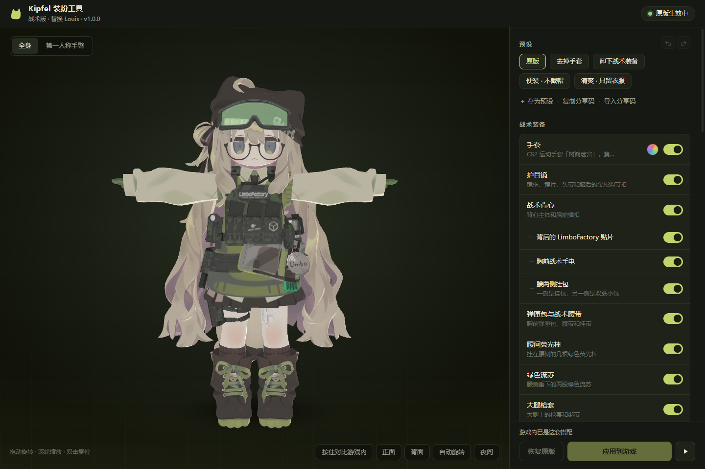

# Kipfel 装扮工具

给 Left 4 Dead 2 创意工坊 mod
[「Kipfel丨可爱猫猫丨夜光丨For Louis」](https://steamcommunity.com/sharedfiles/filedetails/?id=3558183296)
用的换装工具：在 3D 预览里逐件开关装饰、染色、调夜光，一键应用到游戏，随时恢复原版。

> **非官方工具**，与 mod 作者 Mr.limbo 无关。本仓库**不包含 mod 的任何文件**（模型、贴图、材质都不包含），
> 工具只在你自己的电脑上读取你已经订阅的原 mod。使用前请先在创意工坊订阅原 mod。



## 功能

- **3D 实时预览**：直接读取 mod 的模型和贴图渲染（WebGL，带卡通色阶光照），鼠标悬停在某个装饰上，模型对应部位会闪烁。
- **逐件开关 23 件装饰**：手套、护目镜、战术背心及挂件、荧光棒、绿色流苏、猫耳帽（摘下露出猫耳）、帽子后的蝴蝶结、
  眼镜、发夹、领带、瓶盖挂牌、斜挎包、靴子……完整清单见下文。原 mod 里很多不相干的小装饰共用同一个材质，本工具也能把它们分开。
- **染色**：衬衫、针织背心、短裙、发色、手套。
- **夜光强度**：0–100% 可调（原 mod 的夜光在暗处几乎看不出）。
- **游戏开着也能改**：先排队，退出游戏后自动应用。
- **作者更新 mod 后自动同步**你上次应用的搭配。
- 预设、撤销 / 重做、按住对比游戏内的样子、分享码（`KIPFEL3:` 开头的一串文字）。
- **安全检查面板** 和 **完整自检**：随时确认工具没有动到游戏本体和其他 mod（见下文）。

## 安装与运行

需要 Windows、已安装 Left 4 Dead 2，并已订阅原 mod。

**方式一：用 Python 运行（推荐）**

1. 安装 [Python 3](https://www.python.org/downloads/)（3.9 或更新，安装时勾选 *Add python.exe to PATH*）。不需要安装任何第三方库。
2. 下载本仓库（Code → Download ZIP）并解压到任意文件夹。
3. 双击 `打开装扮工具.bat`。会弹出一个独立窗口（使用系统自带的 Edge），关掉窗口工具就自动退出。

**方式二：exe**：在 [Releases](../../releases) 下载 `KipfelWardrobe.exe`，放进一个单独的文件夹后双击运行（会在旁边生成 `data` 文件夹）。

工具会自动从 Steam 的库文件夹里找到游戏；找不到时界面上会让你手动选择游戏的安装文件夹。

## 使用

1. 在右侧开关装饰、染色、调夜光，左侧预览实时变化。
2. 点「应用到游戏」，下次进入游戏生效（游戏开着时按钮会变成「退出游戏后应用」）。
3. 想回到原样，点「恢复原版」。

快捷键：`Ctrl+Z` 撤销、`Ctrl+Y` 重做、`Ctrl+S` 应用。

## 工作原理

1. 读取 `left4dead2/addons/workshop/3558183296.vpk`（只读），在内存里把模型拆成几何上独立的小件，按
   [`kipfel_profile.py`](kipfel_profile.py) 里的规则归到各件装饰。
2. 应用时生成一个本地 addon `left4dead2/addons/kipfel_custom.vpk`：
   - 整个材质都要隐藏的装饰 → 把材质（`.vmt`）改成不显示；
   - 只隐藏共用材质里的一部分（比如只藏瓶盖、保留鱼骨别针）→ 在 Louis 模型的索引文件（`.dx90.vtx`）里
     把这些小件的三角形改成**退化三角形**（三个顶点相同，显卡不会画），文件大小和其他字节都不变；
   - 染色写 `$color2`，夜光用一张 4×4 的纯色遮罩配合 `$selfillummask`；
   - 其余文件（模型、贴图、头像）从原 mod **流式复制、逐字节不变**。
3. 在 `left4dead2/addonlist.txt` 里停用创意工坊版、启用本地版（只改这 2 行）。

## 对游戏和其他 mod 的影响

本工具只会写三处：`addons/kipfel_custom.vpk`、`addonlist.txt` 里本 mod 的 2 行、工具自己的 `data` 文件夹。
游戏本体文件、创意工坊原文件、其他 mod 全部只读。

- 生成的 VPK 先写到临时文件，**逐个文件校验 CRC** 通过后才替换；`.vtx` 的改动逐字节核对，除了被隐藏的三角形一个字节都不许变。
- `addonlist.txt` 按原始字节编辑（不会把非 UTF-8 的条目弄乱），写前备份（第一次改动前的原文件永久保留，另保留最近 10 份），
  写后核对其他 mod 的条目一字未变，不一致就还原。
- 只认自己生成的文件：如果 `addons` 里已有一个不是本工具生成的同名 `kipfel_custom.vpk`，工具不会覆盖或删除它。
- 扫描其他 mod：如果别的 mod 也替换了 Louis，或者也带有 Kipfel 的材质文件夹，安全检查面板会提示。
- 联机时和原 mod 一样，只改变你自己电脑上看到的样子，不影响队友和服务器。
- 本地服务只监听 `127.0.0.1`，接口需要每次启动随机生成的令牌，并校验 Host，页面有严格的 CSP。

「安全检查」右上角的 **完整自检**（或命令行 `python wardrobe.py --selftest`）会在临时文件夹里把应用、恢复、排队、
自动同步、校验等全部跑一遍，最后确认你真实的 `addons` 文件夹和 `addonlist.txt` 与自检前完全一致。

## 装饰清单

每一件都在 3D 预览里单独显示、逐件核对过。

| 分组 | 装饰 |
|---|---|
| 战术装备 | 手套（第一 / 第三人称同步）、护目镜（含脑后金属扣）、战术背心 └ 背后贴片 / 胸前手电 / 腰两侧挂包、弹匣包与战术腰带、腰间荧光棒、绿色流苏、大腿枪套 |
| 头部配饰 | 猫耳帽（摘下露出猫耳头发）└ 帽子后的大蝴蝶结 / 鱼骨别针、圆框眼镜、侧边黑色蝴蝶结、发夹、发尾发圈 |
| 身上配饰 | 领带、Limbo 瓶盖挂牌、透明卡套、斜挎包、大腿创可贴、靴子（含鞋带和扣眼） |
| 只能染色 | 衬衫（连同领带、袖子）、针织背心（连同斜挎包、靴子）、短裙与袜子、发色 |

`└` 表示跟随上一级：父级隐藏时它也一起隐藏。衬衫、背心、短裙这些基础服装只提供染色，不能脱下。

## 尊重原作者

原 mod 作者明确要求**不要把 mod 上传到其他平台、不要二次倒卖**。所以：

- 本仓库和 Releases 里**永远不会**包含 mod 的任何文件；
- 工具生成的 `kipfel_custom.vpk` 里含有原作者的模型和贴图，**只供你自己使用，请不要分享或上传**；
- 想和朋友分享搭配，用「复制分享码」，对方在自己的工具里导入即可。

## 常见问题

**改完进游戏没变化？** 确认游戏是在应用之后才启动的；在游戏「附加内容」里看「Kipfel …（装扮工具自定义）」是否已启用、原版是否已停用。
如果安全检查提示有别的 mod 也替换了 Louis，两个同时启用时游戏只会显示其中一个。

**想完全卸载？** 先点「恢复原版」，再删除工具文件夹即可。`addonlist.txt` 会回到原来的样子。

**作者更新了 mod？** 默认会自动按你上次的搭配重新生成；关掉自动同步后会在界面上提示你手动应用。

## 开发

```
wardrobe.py        本地服务：状态、应用 / 恢复、排队、自动同步、安全检查、HTTP 接口
kipfel_profile.py  mod 描述：文件位置、装饰部件表、预设（适配别的 mod 主要改这里）
srcfmt.py          Source 引擎文件格式：VPK 读写与校验、MDL/VVD/VTX、VTF、拆小件、VTX 退化三角形补丁
selftest.py        需要原 mod 文件的完整流程自检（全部在临时目录里）
web/               界面（原生 JS + WebGL，无第三方库）
tests/             不需要 mod 文件的单元测试
```

```bash
python -m unittest discover -s tests -v   # 单元测试（不需要 mod 文件）
python wardrobe.py --selftest             # 完整自检（需要已订阅原 mod）
```

- 只用 Python 标准库，没有第三方依赖。
- 打开 `http://127.0.0.1:27550/?debug` 后，可以在浏览器控制台用 `kipfelViewer.pieceList()` 列出所有小件、
  `kipfelViewer.focus([...])` 单独显示某些小件，用来核对或新增装饰规则。
- 测试时可以用环境变量 `KIPFEL_GAME_DIR`、`KIPFEL_DATA_DIR`、`KIPFEL_PORT`、`KIPFEL_GAME_EXE` 把工具指向一份测试用的游戏目录副本。

欢迎提 Issue 和 PR。修改部件规则时请在预览里逐件核对，并跑一遍单元测试和自检。

## 许可证

[MIT](LICENSE)。许可证只覆盖本仓库的代码，不涉及原 mod 的任何内容。

---

## English

An unofficial outfit editor for the Left 4 Dead 2 Workshop mod *Kipfel* (ID 3558183296, replaces Louis).
It renders the mod's own model in a WebGL preview, lets you toggle 23 individual accessories, tint clothing and adjust the glow,
then builds a local add-on (`addons/kipfel_custom.vpk`) and switches `addonlist.txt` to it — fully reversible with one click.

- No mod assets are included in this repository; the tool only reads the copy you subscribed to. Do not redistribute the generated VPK.
- Writes only `addons/kipfel_custom.vpk`, two lines of `addonlist.txt` (byte-exact, backed up, verified) and its own `data/` folder.
- Accessories that share a material are hidden individually by turning their triangles into degenerate triangles in the local `.dx90.vtx` copy;
  every write is CRC-verified before it replaces anything.
- Pure Python standard library + vanilla JS. Run `打开装扮工具.bat` (Python 3.9+) or the release exe. Tests: `python -m unittest discover -s tests`.
